# GreenCharge-AI：电动汽车充电场站负荷诊断与碳普惠核算系统

面向 **多场站负荷特征分析、逐小时负荷预测与有序充电策略模拟** 的智能决策原型系统。

> **一句话定位**：把充电场站的订单明细，变成可解释的负荷指标、可验证的负荷预测，
> 以及每一个数字都能追溯到公式或显式假设的运营策略建议。

---

## 这个项目解决什么问题

充电运营商面对的实际问题是三条：

1. **我的场站负荷是什么形态？** 三个场站不能只看总电量 —— 晚峰型、日间平台型、
   双峰型场站需要完全不同的运营手段。
2. **明天几点会来车？** 无法预见的负荷无法调度。有序充电的前提是负荷预测。
3. **把峰时负荷挪到谷时，能挪多少？省多少碳？省多少钱？** —— 且这个数字必须站得住脚。

本系统按这三条组织：

| 问题 | 本系统的回答 | 代码位置 |
| --- | --- | --- |
| 负荷形态 | 负荷率、峰谷差率、谷电利用率、桩利用率、站间相关系数、日型聚类 | `src/metrics.py` |
| 负荷预测 | 逐小时充电量预测，相对最强基线的提升 | `src/features.py`、`src/models.py` |
| 削峰填谷 | `min(E_峰 × θ, H_谷)` + 敏感性分析 + 可审计假设面板 | `src/strategy.py` |

---

## 界面预览

> 截图取自本地运行 `streamlit run app.py`。所用数据为**内置模拟数据，非真实场站数据** ——
> 见下一节。每张图下面标出它对应的方法主张与代码位置。

**① 首页：数据来源状态 + 核心指标**

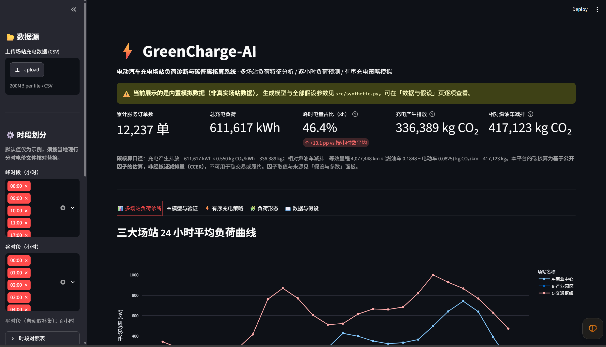

橙色横幅在 KPI **之上**，不滚动即可看见 —— 数据来源状态不该藏进侧边栏。
上传符合数据字典的 CSV 后，横幅切换为「已加载上传数据」，其余全部指标按同一套口径重算。

**② 三个场站的日负荷形态完全不同 —— 这是「多场站」三个字的全部内容**

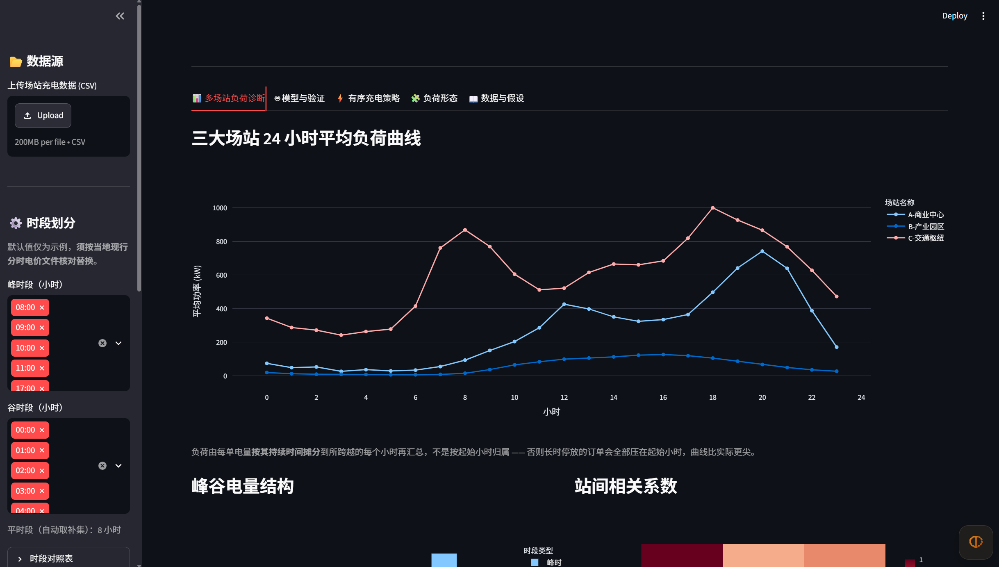

商场（午间小峰 + 晚高峰）、园区（日间平台、夜间近零）、枢纽（整夜持续基线 + 早晚双峰）。
若三个场站只是电量水平不同、形状相同，多场站分析就没有内容 —— 这张图是它非平凡的直接证据。

**③ 描述性指标：峰谷结构、站间相关、负荷特征表**

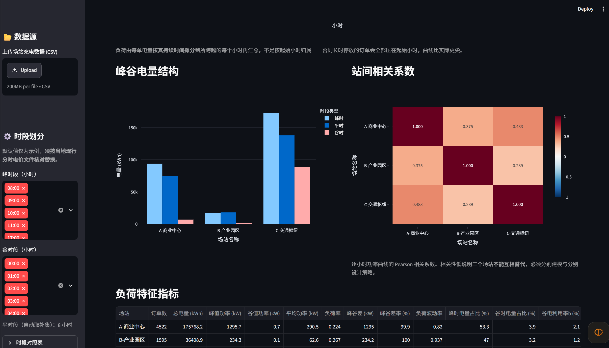

站间相关系数只有 0.289–0.483，说明三个场站不能互相替代，必须分别建模、分别设计策略。
这张表是纯统计，有可引用的定义，不依赖任何模型 —— 它是分析的骨干，不是装饰。

**④ 模型对比：四个模型在同一测试集、同一行集上评分**

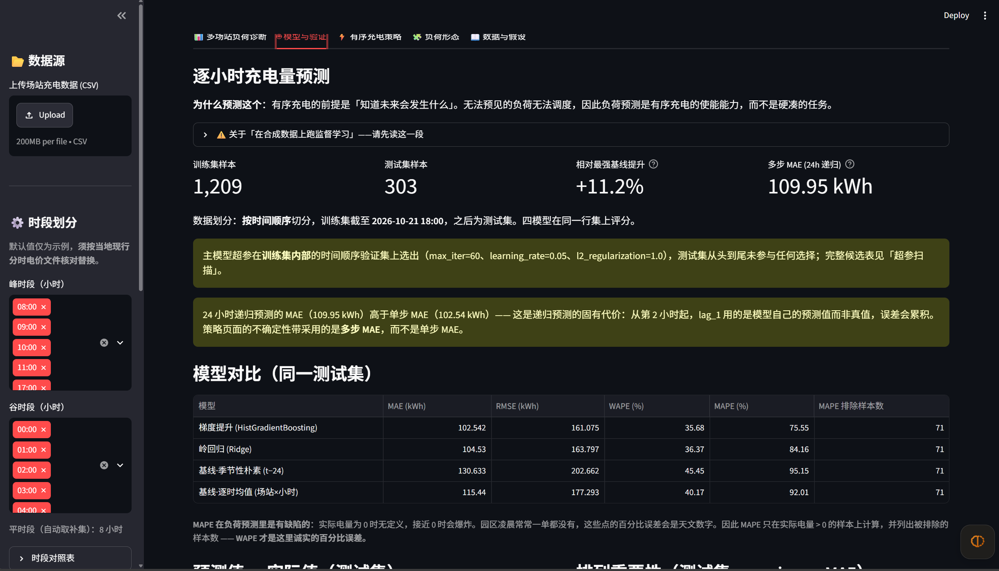

两个**真实基线**（季节性朴素 t−24、逐时均值），不是稻草人。头条是**相对最强基线的提升**，
不是绝对 MAE。超参在**训练集内部**的时间顺序验证集上选出，测试集从头到尾未参与。

**⑤ 预测值 vs 实际值 + 排列重要性 —— 本项目最难伪造的一张图**

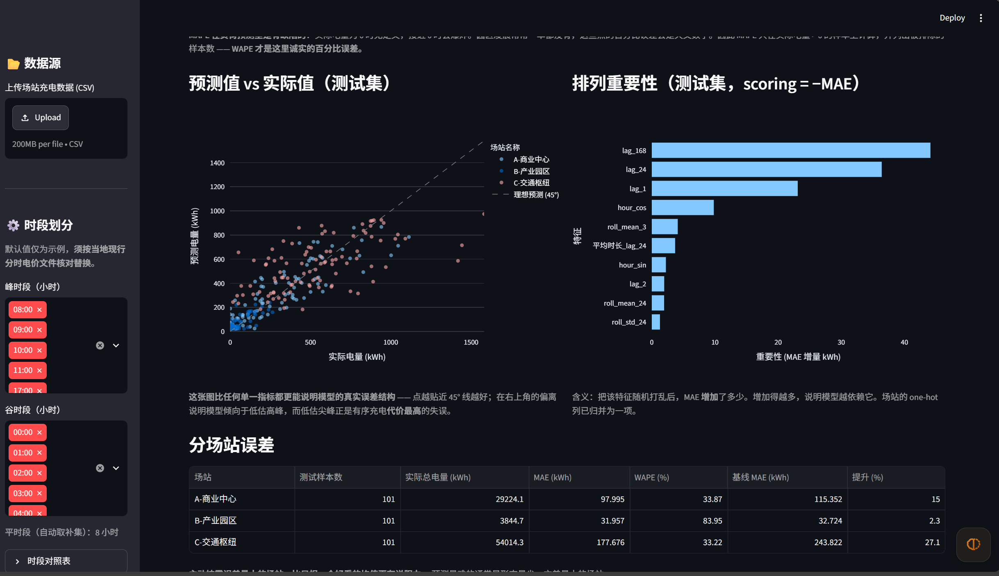

散点围绕 45° 线，右上方偏离说明模型倾向于**低估尖峰** —— 而低估尖峰正是有序充电代价最高的失误。
这张图比任何单一指标都更能说明模型的真实误差结构。排列重要性里 `lag_168`、`lag_24` 居首，
与「负荷有强日周期与周周期」的领域知识一致。

**⑥ 未来 24 小时预测：带不确定性带，而不是一条裸线**

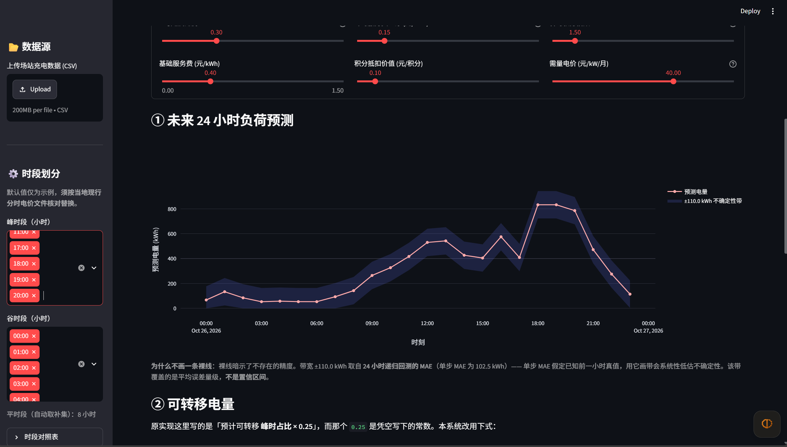

带宽取自 **24 小时递归回测的 MAE**，而不是单步 MAE —— 后者假定已知前一小时真值，
用它画带会系统性低估提前一天的预测误差。裸线暗示了不存在的精度。

**⑦ 可转移电量：`min(E_峰 × θ, H_谷)`**

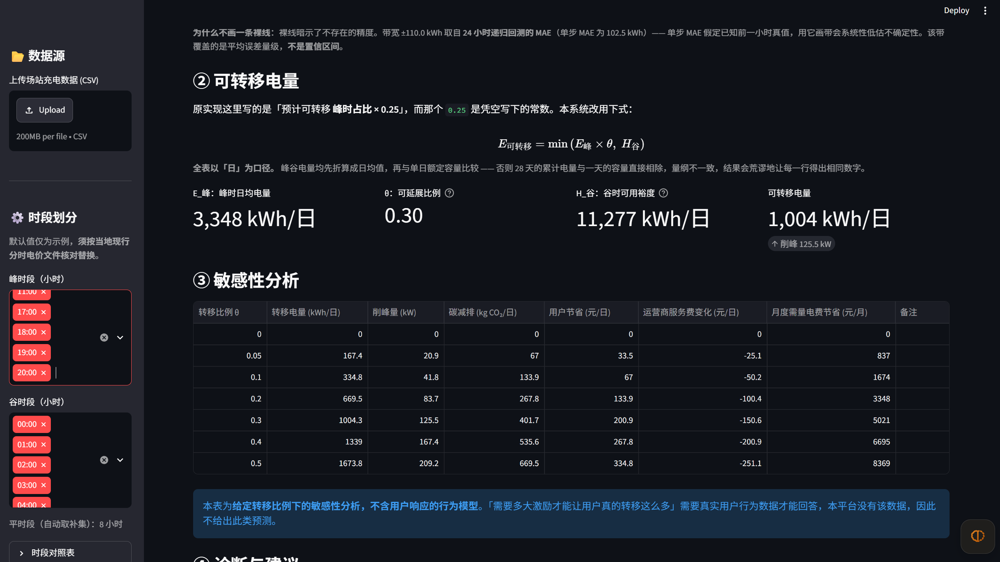

`E_峰` 与 `H_谷` 来自数据，`θ` 是**显式标注的可调假设**（滑块，默认 0.30）。
原实现里写死的 `0.25` 已被替换。下方是给定转移比例下的敏感性表，
**不含用户行为模型** —— 承认不知道什么，比给一个自信的百分比可信。

**⑧ 诊断与建议：随所选场站变化**

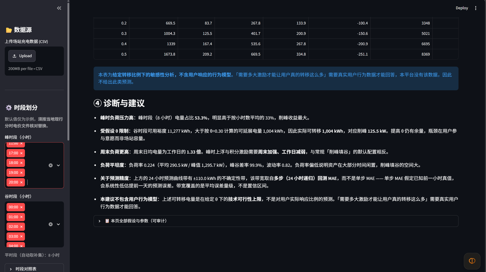

选产业园区 vs 选枢纽，建议文本完全不同。最后一条主动声明本建议不包含用户行为模型。

**⑨ 日负荷形态聚类：k 由轮廓系数扫描决定，不是因为有 3 个场站就定 k=3**

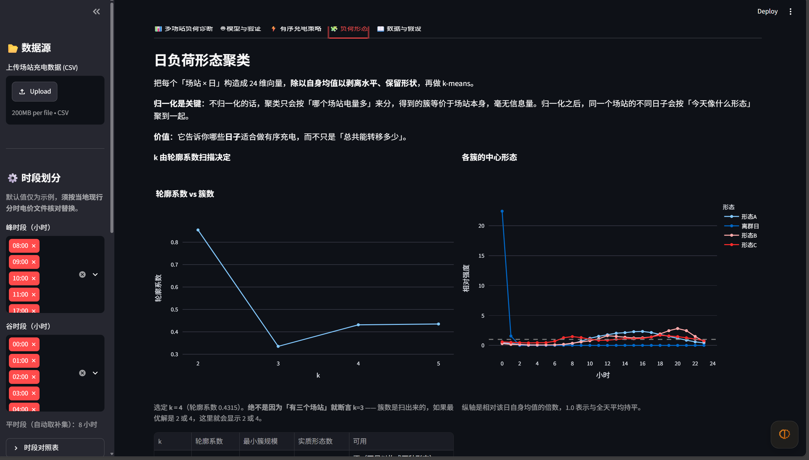

归一化（每日曲线除以自身均值）是关键：不归一化则聚类只会按「哪个场站电量多」分组，
得到的簇等价于场站本身。扫描明细里能看到每个 k 的最小簇规模与实质形态数。

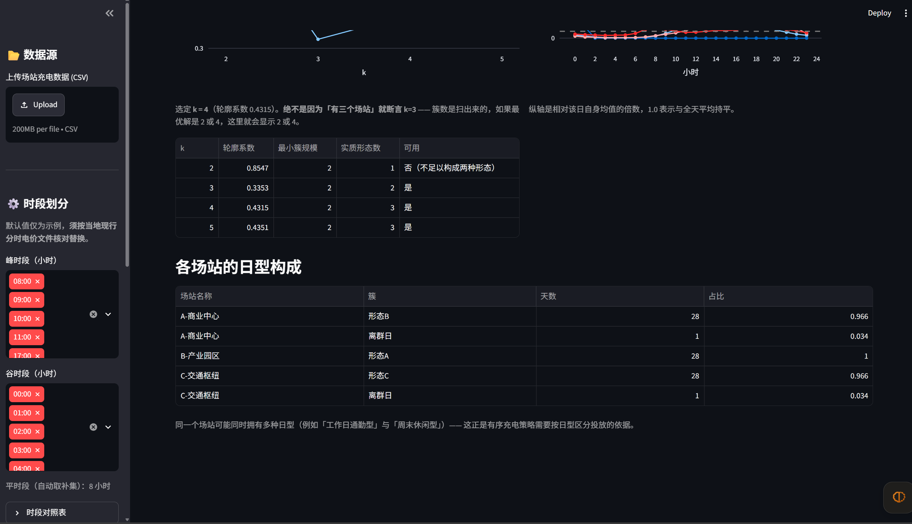

轮廓系数偏好「一个孤立点 + 其余全部」这类划分（k=2 得 0.855，实为 84 天 + 1 天），
但那不是一种运行形态。因此要求至少 `min_cluster_size` 个样本才算实质形态，
过小的簇标为「离群日」。

**⑩ 数据来源、数据字典与模拟生成假设**

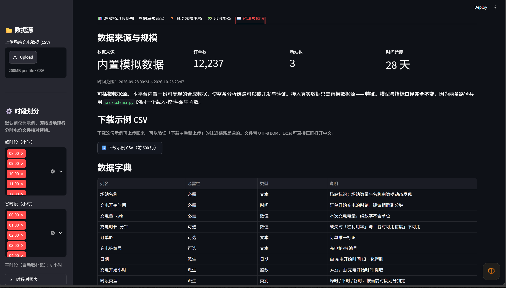

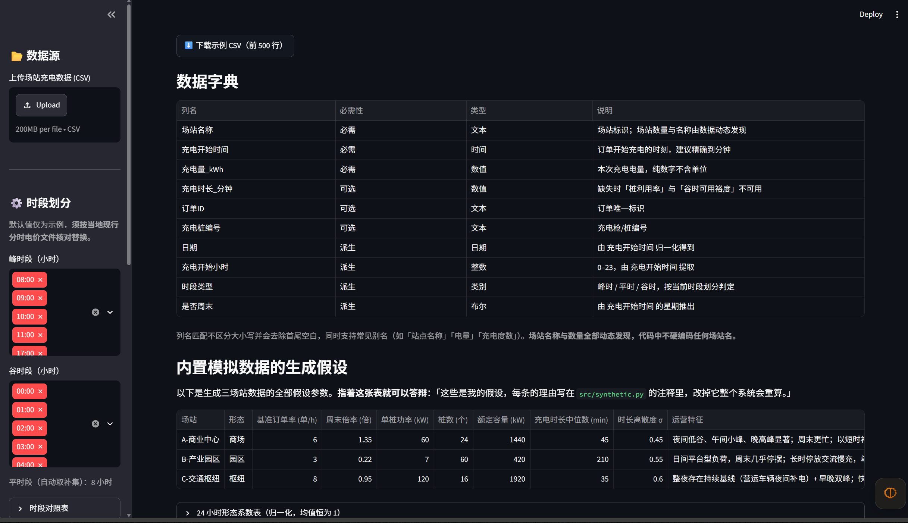

第二张就是答辩时指着说话的那张表：每个参数的值、单位、理由都在 `src/synthetic.py` 的注释里，
改掉它整个系统重算。

**⑪ 碳核算：拆成各自独立命名的参数，而不是一个滑块承担多个物理量**

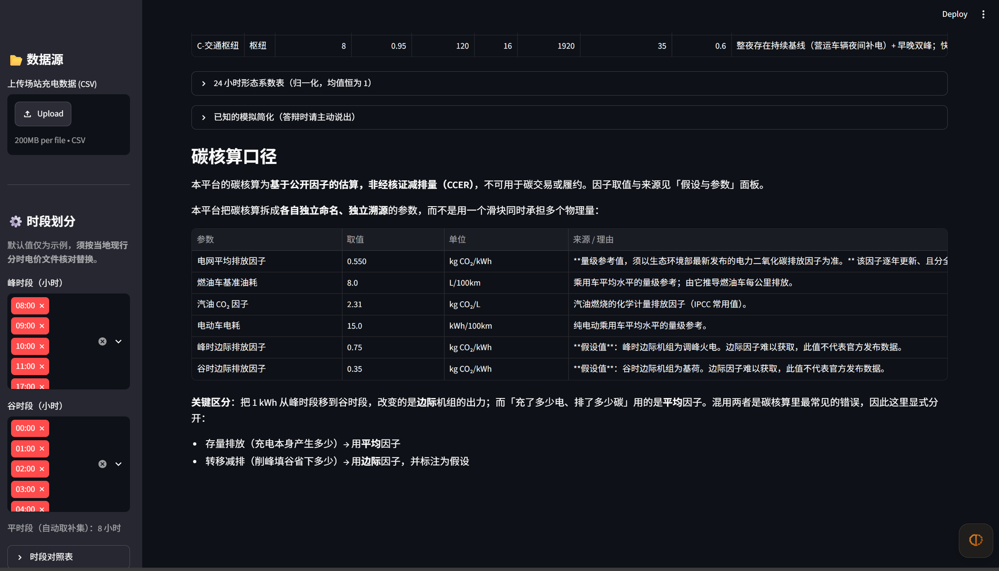

关键区分：**存量排放**（充了多少电、排了多少碳）用平均因子；
**转移减排**（削峰填谷省下多少）用**边际**因子，并显式标注为假设。混用两者是碳核算里最常见的错误。

---

## ⚠️ 关于数据：请先读这一节

**本仓库内置的是模拟数据，不是真实充电场站数据。**

原因：本项目为 AIforGreen 竞赛准备，**真实场站数据在 2026-10-31 开赛现场统一发放**，
赛前无法获取。为了让整条「分析 → 建模 → 策略」链路可以被开发、验证和演示，
本项目用固定随机种子生成了一份形态可信的三场站模拟数据。

**这不是权宜之计，而是刻意的产品设计：**

> 本平台使用**可插拔数据源**。内置合成数据使系统可复现、可演示、可回归测试；
> 接入真实数据只需替换数据源 —— **特征、模型与指标口径完全不变**，
> 因为两条路径共用 `src/schema.py` 中同一个载入-校验-派生函数。

界面上传任意符合数据字典的 CSV，全部分析链路立即在同一套口径下重算。

### 模拟数据是怎么生成的

完整参数与理由见 `src/synthetic.py`，界面「数据与假设」页可逐项查看。摘要：

**① 订单到达 —— 泊松计数过程**

```
λ(s,d,h) = base_s · shape_s(h) · weekend_mult_s^[is_weekend] · day_effect(s,d)
n(s,d,h) ~ Poisson(λ)
```

- `shape_s(h)`：每个场站一张 24 小时形态表，归一化到均值 1
- `day_effect(s,d)`：每个「场站 × 日历日」抽一次，代表天气、促销活动、节假日。
  取 **对数空间 AR(1)** 而非逐日独立：

  ```
  x_d = ρ · x_{d−1} + ε_d,   ε ~ N(0, σ√(1−ρ²)),   day_effect = exp(x_d)
  σ = 0.22（平稳标准差）,  ρ = 0.65（一阶自相关）
  ```

  **为什么必须自相关。** 真实充电量的日间波动主要来自天气与气温，而天气系统是有
  持续性的 —— 今天降温，明天大概率还是冷。逐日独立抽取等于假设「每天的好坏毫无
  关联」，那是把真实世界里的**可预测成分删掉了**，会让「用滞后特征预测」这件事
  在原理上失去价值。ρ=0.65 对应典型的天气过程持续时间（约 2–3 天）。

  ⚠️ **这个参数直接决定模型能比朴素基线好多少**，因此和 σ 一样属于必须披露的
  生成器参数，而不是可以随手调的旋钮：ρ 越大，「昨天同一时刻的电量」对今天的
  指示意义越强，模型相对基线的优势越大。**真实场站的 ρ 是多少需要真实数据才能
  估计，本项目不作断言。** 新息标准差取 `σ√(1−ρ²)` 是为了让平稳方差仍为 σ²，
  这样单独改变 ρ 不会顺带改变日效应的整体波动幅度。

**② 单次充电 —— 时长与电量物理挂钩**

```
D ~ LogNormal(μ_s, σ_s)   截断到 [10, 600] 分钟
E = P_s · (D/60) · η,     η ~ Uniform(0.60, 0.95)
```

即 **电量 = 额定功率 × 充电时长 × 充电效率**。这让 `充电时长_分钟` 成为电量的
真实解释变量，两者互相自洽 —— 否则数据一眼就能看出是编的。

**③ 三个场站的形态参差**

| 场站 | 形态 | 小时曲线特征 | 周末倍率 | 桩配置 |
| --- | --- | --- | --- | --- |
| A-商业中心 | 商场 | 夜间低谷 → 午间小峰(12点) → **晚高峰(18–21点)** | 1.35 | 24 × 60 kW |
| B-产业园区 | 园区 | 夜间近零 → **日间平台(09–16点)** | **0.22** | 60 × 7 kW |
| C-交通枢纽 | 枢纽 | **整夜持续基线**(营运车) + **早晚双峰(7/18点)** | 0.95 | 16 × 120 kW |

选这三者，是因为它们产生**性质不同的曲线形状**，而不只是水平不同 ——
这正是「多场站负荷诊断」非平凡、预测有意思的原因。

### 已知的模拟简化（主动披露）

- 无排队模型：订单到达与时长独立抽取，理论上同时充电数可能略超桩数
- 不建模电池充满后的提前结束，长时停放订单的电量不设上限
- 跨零点订单全部计入起始小时，夜间负荷被轻微低估
- 日效应按场站独立抽取，未建模同城场站之间的天气相关性（各自独立 AR(1)）

---

## 快速开始

### 1. 环境要求

**Python ≥ 3.11**（`pandas 3.x` 与 `streamlit 1.66` 的下限）。
本项目在 **Python 3.14.3 / Windows 11** 上开发与验证。

### 2. 安装

```powershell
cd GreenCharge-AI
python -m venv .venv
.\.venv\Scripts\Activate.ps1          # macOS / Linux: source .venv/bin/activate
python -m pip install --upgrade pip
python -m pip install --only-binary=:all: -r requirements.txt
```

**`--only-binary=:all:` 不是装饰。** 它强制只接受预编译轮子，
从而保证**不需要 C 编译器**。`numpy` / `scipy` / `pyarrow` 若走源码编译，
在评委的机器上极可能因为缺少编译器而失败。

### 3. 运行

```powershell
python -m streamlit run app.py
```

浏览器打开 `http://localhost:8501`。

### 4. 复现模型指标（不需要启动界面）

```powershell
python scripts\evaluate.py
```

该脚本复用 `src/models.py` 的 `train_and_evaluate()`，**不重复实现任何逻辑** ——
因此 README 里的数字与界面上显示的数字必然一致，不存在两套口径。

---

## 数据字典

**必需三列**，其余可选。列名匹配不区分大小写、会去除首尾空白，
并支持常见别名（「站点名称」「电量」「充电度数」等）。

| 列名 | 必需性 | 类型 | 说明 |
| --- | --- | --- | --- |
| `场站名称` | 必需 | 文本 | 场站标识。**场站数量与名称由数据动态发现，代码中不硬编码任何场站名** |
| `充电开始时间` | 必需 | 时间 | 订单开始充电的时刻，建议精确到分钟 |
| `充电量_kWh` | 必需 | 数值 | 本次充电电量，纯数字不含单位 |
| `充电时长_分钟` | 可选 | 数值 | 缺失时「桩利用率」与「谷时可用裕度」显示为「—」 |
| `订单ID` | 可选 | 文本 | 订单唯一标识 |
| `充电桩编号` | 可选 | 文本 | 充电枪/桩编号 |

**派生列**（由系统生成，请勿在文件中提供）：
`日期`、`充电开始时间` 的小时、`时段类型`（峰时/平时/谷时）、`是否周末`。

### 编码处理

按 `utf-8-sig` → `gb18030` → `utf-8` 依次回退。

`utf-8-sig` 放第一位是刻意的：**Excel 导出的 CSV 带 UTF-8 BOM**，
首列名会变成 `场站名称`，表现为一个非常诡异的「明明有这一列却报缺列」的
`KeyError`。系统同时会剥离列名中的 BOM 字符。

上传失败时，界面会列出**实际读到的列名**，而不是把 traceback 抛到屏幕上。

---

## 方法说明

### 特征工程：防泄漏是全部要点

时序预测里最常见、也最隐蔽的造假，是让第 t 小时的特征里混进 t 或 t 之后的信息。
本项目用两条规则杜绝它：

1. **所有滞后与滚动统计都先 `shift` 再 `rolling`。**
   `lag_1` 是 t−1 小时的电量；滚动窗口在**已平移的序列**上计算，窗口内最大值是 t−1。
2. **当期聚合量一律不作特征。**
   `订单数`、`平均时长`、`单均电量` 都是**当期**统计量，要到该小时结束才知道。
   把它们当特征，等于把答案的一部分喂给模型。因此它们只以**滞后值**形式入模。

做错这两条会让指标显著虚高，而且从结果上看不出任何异常。

### 数据划分：按时间顺序，不随机打乱

留出最后 20% 作测试集。`train_test_split(shuffle=True)` 会让时序模型从测试期的
相邻小时「看到」未来（`lag_1` 直接泄漏），指标虚高；按时间顺序划分才是真实部署条件。

### 模型选择

| 模型 | 作用 |
| --- | --- |
| `HistGradientBoostingRegressor` | **主模型**。原生处理 NaN、无额外依赖、能捕捉「小时 × 场站」交互 |
| `Pipeline(SimpleImputer, StandardScaler, Ridge)` | **可解释对照组**。证明增加的复杂度是实测换来的 |
| 季节性朴素（t−24） | **真实基线一**。日周期是充电负荷最强的规律 |
| 逐时均值（场站 × 小时） | **真实基线二**。比朴素法更强 |

**`early_stopping=False` 是刻意的**：sklearn 默认 `'auto'` 会从训练数据里**随机**
切出验证集 —— 在时序数据上这是跨时间泄漏。

**超参怎么选的 —— 这一条比超参本身重要。** 轮数不由 sklearn 自动决定，而是
把训练集再按时间顺序切一刀（前 85% 内部训练 / 后 15% 内部验证），在内部验证集上
扫 45 个组合（`max_iter` × `learning_rate` × `l2_regularization`），取最优后
**回到完整训练集重训**。测试集从头到尾没有参与任何选择。

这不是形式主义。默认的 300 轮 + 低学习率在这个规模（约 1200 行）上明显过拟合：
实测测试集 MAE 111.2，**反而不如岭回归的 104.5** —— 一个「用了更复杂的模型却更差」
的结果。调参后为 102.5，才真正优于岭回归。完整候选表由
`ModelReport.hgb_search` 携带，界面上可查，「怎么选的」可被审计。

**被否决的模型**：OLS（无法表达「小时 × 场站」交互）；随机森林（无法外推、更慢）；
XGBoost/LightGBM（本数据规模上收益边际，而 Python 3.14 轮子无保证，
是真实的安装失败风险）；LSTM（无 GPU、样本量不够、答辩讲不通）。

### 指标口径

| 指标 | 公式 | 说明 |
| --- | --- | --- |
| **MAE** (kWh) | `(1/n)Σ\|y−ŷ\|` | 物理单位，不需要翻译 |
| **RMSE** (kWh) | `√((1/n)Σ(y−ŷ)²)` | 惩罚大偏差 —— 低估尖峰代价最高 |
| **WAPE** (%) | `Σ\|y−ŷ\| / Σ\|y\| × 100%` | **负荷预测中诚实的百分比误差** |
| MAPE (%) | `(100/n)Σ\|y−ŷ\|/\|y\|` | ⚠️ 见下方警告 |
| **相对基线提升** | `1 − MAE_模型 / MAE_最强基线` | **头条指标** |

**关于 MAPE 的警告**：MAPE 在负荷预测里是有缺陷的 —— 实际电量为 0 时无定义，
接近 0 时会爆炸。园区凌晨常常一单都没有，这些点的百分比误差会是天文数字。
因此本系统只在实际电量 > 0 的样本上计算 MAPE，并**显示被排除的样本数**。
**WAPE 才是这里诚实的百分比误差。**

### 为什么头条是「相对提升」而不是绝对 MAE

生成器是本项目自己写的，再拿它产出的数据训练模型，必然会被问：
**「你自己写生成器再预测它，误差当然小。」**

三点回答：

1. 生成器含**真正不可预测的成分** —— 泊松到达噪声 + AR(1) 日效应中每步的新息
   `ε_d`。日效应是模型看不到的隐变量，只能从滞后特征里间接估计，而**当天的新息
   在物理上就不可能在当天之前被观测到**，因此误差是真实的，不是「背下了生成器公式」。
2. **「比最强基线好多少」衡量的是建模流程本身的价值。** 绝对 MAE 会随生成器参数
   变化，相对提升对 `base_s`、`shape_s` 这类**水平类**参数不敏感。
3. **但要诚实承认它的限度**：相对提升**并非与生成器完全无关** —— 它取决于日效应
   的自相关强度 ρ（见上文）。ρ 越大，滞后特征越有信息量，模型优势越大。ρ 是我们
   选的，不是从真实数据估出来的。**因此这个百分比证明的是流程正确，不是真实场站上
   的预期收益。**
4. **本指标验证的是建模流程的正确性** —— 防泄漏特征、时序划分、基准对照、
   调参不碰测试集、评估口径。**绝对精度是模拟数据的属性。**

---

## 评估结果

<!-- EVAL_OUTPUT_START -->
以下为 `python scripts/evaluate.py` 的**实际运行输出**（2026-10-16，Windows 11 / Python 3.14.3 / pandas 3.0.6 / numpy 2.5.4）。
**连跑两次输出逐字相同** —— 随机种子固定为 42，所有随机数发生器在函数内部创建，不触碰全局状态。复现命令见上一节。

```text
==============================================================================
GreenCharge-AI  模型评估报告
==============================================================================
生成工具   : scripts/evaluate.py
随机种子   : 42（固定，任何机器上结果一致）
库版本     : pandas 3.0.6 / numpy 2.5.4

⚠️  本报告基于**内置模拟数据**，不是真实充电场站数据。
    指标验证的是**建模流程**（防泄漏特征、时序划分、基准对照、评估口径）
    的正确性；绝对精度是模拟数据的属性，不代表真实场站的预测精度。

—— 1. 数据规模 -------------------------------------------------------------------
数据来源   : 内置模拟数据
订单总数   : 12,237 单
场站数量   : 3 个 —— A-商业中心 / B-产业园区 / C-交通枢纽
时间跨度   : 2026-09-28 00:24 → 2026-10-25 23:47（28 天）
总电量     : 611,617.2 kWh

—— 2. 各场站订单特征（形态不同的直接证据） -----------------------------------------------------
  场站名称  订单数   总电量_kWh  单均电量_kWh  单均时长_min
A-商业中心 4522 175768.19     38.87     50.14
B-产业园区 1595  36408.90     22.83    250.36
C-交通枢纽 6120 399440.07     65.27     42.11

—— 3. 多场站负荷特征 ----------------------------------------------------------------
    场站  订单数  总电量 (kWh)  峰值功率 (kW)  谷值功率 (kW)  平均功率 (kW)   负荷率  峰谷差 (kW)  峰谷差率 (%)  负荷波动率  峰时电量占比 (%)  谷时电量占比 (%)  谷电利用率b (%)  桩利用率 (%)
A-商业中心 4522   175768.2     1295.7        0.7      290.5 0.224    1295.0      99.9  0.820        53.3         3.9         2.1      23.5
B-产业园区 1595    36408.9      234.3        0.1       62.6 0.267     234.2     100.0  0.937        47.0         3.2         1.2      16.8
C-交通枢纽 6120   399440.1     1740.4       20.5      592.6 0.341    1719.8      98.8  0.532        43.3        22.1        20.5      40.0

资产假设（模拟数据自带，真实数据需另行提供）：
  A-商业中心: 24 桩 × 60 kW = 额定容量 1,440 kW
  B-产业园区: 60 桩 × 7 kW = 额定容量 420 kW
  C-交通枢纽: 16 桩 × 120 kW = 额定容量 1,920 kW

指标口径说明：
  负荷率     = 平均功率 / **实测**峰值功率（不是合同容量）
  峰谷差率   = 峰谷差 / **实测**峰值功率 × 100%
  谷电利用率b= 谷时**日均**电量 / (额定容量 × 谷时小时数) × 100%
  桩利用率   = Σ充电时长 / (桩数 × 统计时长) × 100%
  注：额定容量相关指标在未提供容量时为「—」，不用默认值冒充。

—— 4. 站间相关系数（逐小时功率曲线） --------------------------------------------------------
场站名称    A-商业中心  B-产业园区  C-交通枢纽
场站名称                          
A-商业中心   1.000   0.375   0.483
B-产业园区   0.375   1.000   0.289
C-交通枢纽   0.483   0.289   1.000

—— 5. 特征与数据划分 ----------------------------------------------------------------
聚合粒度   : 场站 × 小时（缺失小时已补零，避免滞后特征在时间轴上错位）
预热丢弃   : 504 行（lag_168 需要 168 小时前置数据）
有效样本   : 1,512 行 × 20 个特征
特征清单   : hour_sin, hour_cos, dow_sin, dow_cos, is_weekend, lag_1, lag_2, lag_3, lag_24, lag_168, roll_mean_3, roll_mean_24, roll_std_24, 订单数_lag_1, 订单数_lag_24, 单均电量_lag_24, 平均时长_lag_24, 场站_A-商业中心, 场站_B-产业园区, 场站_C-交通枢纽

—— 6. 模型对比（同一测试集，同一行集） -------------------------------------------------------
训练集     : 1,209 行（2026-10-05 → 2026-10-21 18:00）
测试集     : 303 行（2026-10-21 18:00 之后）
划分方式   : **按时间顺序**留出最后 20%，不做随机打乱

主模型超参 : {'max_iter': 60, 'learning_rate': 0.05, 'l2_regularization': 1.0}（在**训练集内部**的时间顺序验证集上选出，测试集未参与）

超参扫描前 5 名（内部验证集，共 45 个候选）：
 max_iter  learning_rate  l2_regularization  内部验证 MAE (kWh)
       60           0.05                1.0         111.672
      100           0.03                1.0         112.153
      100           0.03                0.1         112.454
      100           0.03                0.0         112.544
       60           0.05                0.1         113.082

                         模型  MAE (kWh)  RMSE (kWh)  WAPE (%)  MAPE (%)  MAPE 排除样本数
梯度提升 (HistGradientBoosting)    102.542     161.075     35.68     75.55          71
                岭回归 (Ridge)    104.530     163.797     36.37     84.16          71
            基线·季节性朴素 (t−24)    130.633     202.662     45.45     95.15          71
            基线·逐时均值 (场站×小时)    115.440     177.293     40.17     92.01          71

最强基线   : 基线·逐时均值 (场站×小时)（MAE 115.440 kWh）
相对提升   : +11.2%   ← **头条指标**

为什么头条是「相对提升」而不是绝对 MAE：
  绝对 MAE 是模拟数据的属性，会随生成器参数变化；
  而「比最强基线好多少」衡量的是建模流程本身的价值，与数据来源无关。

  主模型超参在**训练集内部**的时间顺序验证集上选出（max_iter=60、learning_rate=0.05、l2_regularization=1.0），测试集从头到尾未参与任何选择；完整候选表见「超参扫描」。
  24 小时递归预测的 MAE（109.95 kWh）高于单步 MAE（102.54 kWh）—— 这是递归预测的固有代价：从第 2 小时起，lag_1 用的是模型自己的预测值而非真值，误差会累积。策略页面的不确定性带采用的是**多步 MAE**，而不是单步 MAE。

—— 7. 分场站误差（主模型 vs 季节性朴素基线） --------------------------------------------------
    场站  测试样本数  实际总电量 (kWh)  MAE (kWh)  WAPE (%)  基线 MAE (kWh)  提升 (%)
A-商业中心    101      29224.1     97.995     33.87       115.352    15.0
B-产业园区    101       3844.7     31.957     83.95        32.724     2.3
C-交通枢纽    101      54014.3    177.676     33.22       243.822    27.1

主动披露误差最大的场站 —— 一个好看的均值不如一个诚实的分布。

—— 8. 排列重要性 Top 8（测试集，scoring = −MAE） ----------------------------------------
         特征  重要性 (MAE 增量 kWh)
    lag_168           44.1043
     lag_24           36.3938
      lag_1           23.1006
   hour_cos            9.8135
roll_mean_3            4.1102
平均时长_lag_24            3.6895
   hour_sin            2.2330
      lag_2            1.9649

—— 9. 多步回测（24 小时递归预测） --------------------------------------------------------
单步 MAE   : 102.542 kWh
多步 MAE   : 109.953 kWh
倍率       : 1.07×

单步 MAE 是「已知前一小时真值」条件下的误差；有序充电需要的是
提前**一整天**的预测。从第 2 小时起，lag_1 用的是模型自己的预测值，
误差会累积。策略页面画不确定性带时采用的是**多步 MAE**，
因为用单步 MAE 会系统性低估不确定性。

—— 10. 日负荷形态聚类（无监督） ----------------------------------------------------------
k 由轮廓系数扫描决定，**不是因为有 3 个场站就定 k=3**：

 k   轮廓系数  最小簇规模  实质形态数           可用
 2 0.8547      2      1 否（不足以构成两种形态）
 3 0.3353      2      2            是
 4 0.4315      2      3            是
 5 0.4351      2      3            是

选定 k = 4（轮廓系数 0.4315）

归一化是关键：每天曲线除以自身均值，剥离水平、保留形状。
否则聚类只会按「哪个场站电量多」分组，得到的簇等价于场站本身。

  场站名称   簇  天数    占比
A-商业中心 形态B  28 0.966
A-商业中心 离群日   1 0.034
B-产业园区 形态A  28 1.000
C-交通枢纽 形态C  28 0.966
C-交通枢纽 离群日   1 0.034

—— 11. 有序充电敏感性分析（以第一个场站为例） ---------------------------------------------------
场站       : A-商业中心
θ          : 0.30（可调假设，非实测值）
E_峰       : 3,347.5 kWh
H_谷裕度   : 11,277.1 kWh（额定容量 × 谷时小时 − 谷时电量）
可转移电量 : min(E_峰 × θ, H_谷) = 1,004.3 kWh
约束来源   : θ

 转移比例 θ  转移电量 (kWh/日)  削峰量 (kW)  碳减排 (kg CO₂/日)  用户节省 (元/日)  运营商服务费变化 (元/日)  月度需量电费节省 (元/月) 备注
   0.00           0.0       0.0             0.0         0.0            -0.0             0.0   
   0.05         167.4      20.9            67.0        33.5           -25.1           837.0   
   0.10         334.8      41.8           133.9        67.0           -50.2          1674.0   
   0.20         669.5      83.7           267.8       133.9          -100.4          3348.0   
   0.30        1004.3     125.5           401.7       200.9          -150.6          5021.0   
   0.40        1339.0     167.4           535.6       267.8          -200.9          6695.0   
   0.50        1673.8     209.2           669.5       334.8          -251.1          8369.0   

本表为**给定转移比例下的敏感性分析，不含用户响应的行为模型**。「需要多大激励才能让用户真的转移这么多」需要真实用户行为数据才能回答，本平台没有该数据，因此不给出此类预测。

—— 12. 确定性检查 -----------------------------------------------------------------
generate() 连续两次调用结果逐位相同：True
（随机数发生器在函数内部创建，不使用 np.random.seed 修改全局状态）
```
<!-- EVAL_OUTPUT_END -->

---

## 负荷指标口径

| 指标 | 公式 | 口径说明 |
| --- | --- | --- |
| 负荷率 | `P_avg / P_max` | `P_max` 取**实测**小时峰值，不是合同容量。两者会给出不同数值 |
| 峰谷差 | `P_max − P_min` | |
| 峰谷差率 | `(P_max − P_min) / P_max × 100%` | 分母明确采用**实测峰值**；另一版本以额定容量为分母 |
| 谷电利用率 (a) | `E_谷 / E_总 × 100%` | 稳健，无需容量假设 |
| 谷电利用率 (b) | `E_谷 / (P_额 × T_谷) × 100%` | 对比可用容量，需要额定容量 |
| 峰时电量占比 | `E_峰 / E_总 × 100%` | |
| 负荷波动率 | `σ(P) / P_avg` | 变异系数，无量纲的尖峰度 |
| 站间相关系数 | 各站 24h 曲线的 Pearson r | 相关性低说明场站不能互相替代，须分别建模 |
| 桩利用率 | `ΣD_i / (N_桩 × T × 60) × 100%` | 需要「充电时长_分钟」与桩数 |

**两个「谷电利用率」都展示并标注。** 单个未标注的「谷电利用率」是有歧义的：
分母是总电量还是可用容量，会给出完全不同的数值。

**负荷曲线由每单电量按其持续时间摊分**到所跨越的每个小时，而不是按起始小时归属 ——
否则园区 3.5 小时的订单会把全部电量压在起始那一小时，曲线比实际更尖。
桶宽恰好 1 小时，因此桶内 kWh 数值上就等于该小时的平均功率 kW。

---

## 时段划分

> **示例划分，非事实陈述。** 默认值为 **谷 00–08 / 峰 08–12 与 17–21 / 平其余**，
> 是华东地区常见的两峰一谷结构。**本平台不宣称知道任何地区的现行时段边界**，
> 上线前须按当地现行分时电价文件核对替换。

侧边栏可实时编辑峰、谷时段（平时段自动取补集），全部指标随之下算 ——
这是为了让评委看到它们是**参数而非事实**。

---

## 碳核算口径

### 三处关键区分

**① 「电量 × 因子」是排放，不是减排。**

充电**消耗**电力因而**产生**排放。把它称为「碳减排量」，
只在相对某个基准线时才成立 —— 本项目明确采用**被替代的燃油车**作为基准线：

```
EF_EV每公里   = 电耗(kWh/100km)/100 × EF_电网平均
EF_燃油每公里 = 油耗(L/100km)/100 × 2.31 (kg CO₂/L)
减排量        = 等效里程 × (EF_燃油每公里 − EF_EV每公里)
```

**② 削峰填谷用边际因子，不用平均因子。**

把 1 kWh 从 19 点移到 3 点，改变的是**边际**机组的出力 ——
19 点的边际机组是燃气/煤电调峰，03 点是基荷。平均因子适合算存量排放，
**边际因子才是转移类主张的正确选择**。两者在本系统中是**分开的、各自命名的参数**。

**③ 五个参数各自独立命名、独立溯源。**

原实现用**单个滑块**同时承担了电网排放因子这一件事。本系统拆开：

| 参数 | 用途 | 取值来源 |
| --- | --- | --- |
| `EF_电网平均` | 存量排放（充电本身产生多少） | **生态环境部逐年发布，须查最新官方值** |
| `EF_燃油每公里` | 减排基准线 | 由 L/100km × kg CO₂/L 推导 |
| `电耗` | 电动车能耗 | 参数，界面可调 |
| `EF_边际峰` | 转移减排 | **显式标注为假设** |
| `EF_边际谷` | 转移减排 | **显式标注为假设** |

> **本平台的碳核算为基于公开因子的估算，非经核证减排量（CCER），
> 不可用于碳交易或履约。**

---

## 有序充电策略：那个凭空常数是怎么被修掉的

原实现写着「预计可转移 **峰时占比 × 0.25**」，而那个 `0.25` 没有任何来源。
一个编造的数字足以毁掉整个项目的可信度 —— 评委只需要问一句「这个 0.25 是怎么来的」。

现在改为：

```
可转移电量 = min( E_峰 × θ ,  H_谷 )
```

- `E_峰` —— 峰时段总电量，**来自数据**
- `θ` —— 可延展比例，**用户滑块，显式标注为假设**
- `H_谷` —— 谷时可用裕度 = `额定容量 × 谷时小时数 − 谷时实际电量`，**由数据导出**

这个式子**不可能**是任意的：它是「数据导出的物理容量」与「已披露的可调假设」取小。

而且它会产生真实的运营发现：**当 `H_谷` 成为约束时**，
界面会明确说出「受谷时可用裕度限制」—— 这说明瓶颈不在用户意愿，
而在谷时段本身已接近满载，继续加码激励不会有效。
这比一个魔法常数有意思得多。

### 不做的部分

**本系统不建模用户响应行为。** 我们不会声称「1.5 倍积分会使 30% 的用户转移充电」——
那需要真实的用户行为数据，而我们没有。

提供的是**给定转移比例下的敏感性分析**：每一行都是显式公式，
把「不知道的部分」作为自变量交给用户。
**承认自己不知道什么的敏感性表，远比一个自信的百分比可信。**

### 假设面板

每页底部都有「本页全部假设与参数」面板，把每个可调项渲染成可审计的表：
参数、取值、单位、来源/理由。面板的值与参与计算的值来自**同一个 dataclass 实例**，
因此两者不可能漂移。

---

## 项目结构

```
GreenCharge-AI/
├── app.py              # Streamlit 界面 —— 只做展示，零计算
├── requirements.txt    # 锁定实测通过的版本
├── src/
│   ├── schema.py       # 数据契约、时段划分、载入/校验/派生（唯一入口）
│   ├── synthetic.py    # 模拟数据生成器（唯一的假设来源）
│   ├── metrics.py      # 负荷指标、碳核算、日型聚类
│   ├── features.py     # 特征工程（防泄漏）
│   ├── models.py       # 训练 / 评估 / 预测
│   └── strategy.py     # 有序充电策略与假设面板
└── scripts/
    └── evaluate.py     # 命令行评估，输出可粘贴的指标报告
```

**最重要的一条结构规则：`app.py` 里不做任何计算。**
屏幕上出现的每一个数字，都由 `src/` 里的某个具名函数产出，
于是「这个数是怎么来的」永远有一个明确答案 ——
「看 `src/metrics.py` 的 `load_factor`」。

---

## 依赖与版本锁定

```
streamlit==1.66.0
pandas==3.0.6
scikit-learn==1.9.1
plotly==7.1.0
numpy>=2.3.3,<3
```

**只锁顶层依赖，不锁传递依赖。**

**为什么必须锁版本**：`streamlit` 的 `use_container_width` 参数已弃用，
其移除目标日期（2025-12-31）已经过去。若放开版本范围，pip 可能拉到已经删除该参数的
版本，应用会在演示前直接 `TypeError` 崩溃。同样的理由适用于 `pandas 3.0`
的一系列破坏性变更（见下）。

### pandas 3.0 的破坏性变更（本项目已适配）

| 变更 | 本项目如何应对 |
| --- | --- |
| 字符串列使用新的 `str` dtype | 列类型判断不使用 `select_dtypes(include="object")` |
| 写时复制是唯一模式，链式赋值静默失效 | 所有条件写入使用 `df.loc[mask, col] = value` |
| `datetime64` 精度改为微秒 | `.dt.hour` / `.dt.floor()` 不受影响 |
| `read_csv` 移除 `delim_whitespace` / `date_parser` 等参数 | 只使用 `dtype=` 与 `encoding` |
| 频率别名 `"H"` → `"h"` | 统一使用小写别名 |

`.venv/` 与 `__pycache__/` 已在 `.gitignore` 中排除。

---

## 竞赛相关说明

- **赛道**：B 赛道（开放创新）—— 要求具备数据分析能力，鼓励产品化、
  交互设计与实际应用价值，可自行选择任何人工智能方法。
- **数据**：真实场站数据于 2026-10-31 开赛现场发放，赛前不可获取。
  本仓库的模拟数据生成器即为应对该约束而设计，且已按「可插拔数据源」组织。
- **AI 工具使用**：本项目在开发过程中使用了 AI 编程工具。
  竞赛规则要求如实说明，此处如实说明。
- **赛前准备的通用工具与公开代码**：本项目全部代码为本队编写；
  使用的第三方库（Streamlit / pandas / scikit-learn / Plotly）均为公开开源软件，
  已在 `requirements.txt` 中列明版本。
